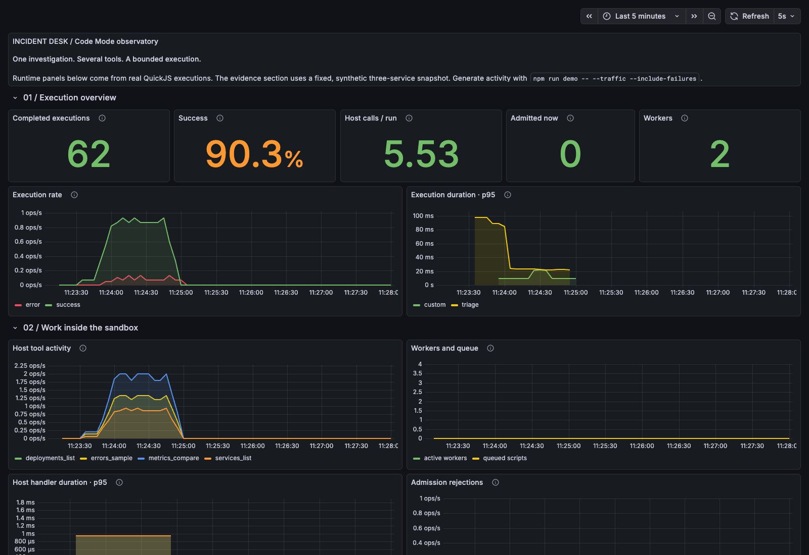
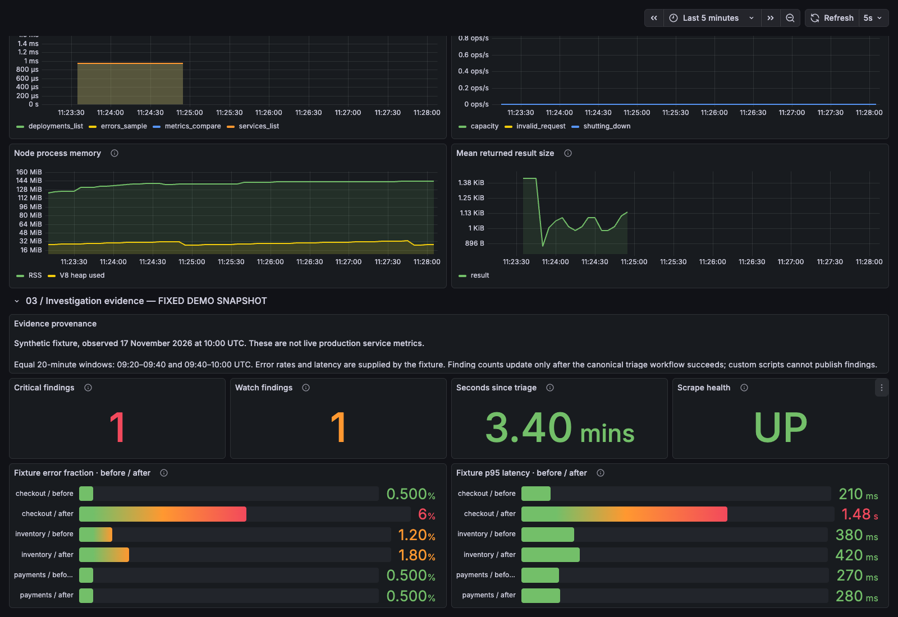

# From tool calls to Code Mode with NitroStack and Grafana

You asked a chat assistant how to investigate a checkout failure. It described the steps, and you opened the monitoring tools to carry them out. You chose the queries and pasted the results back into the chat.

Developers connected models to tools so assistants could take action. A model could request an order record or query a database, read the response, and choose its next step. Through that loop, an agent could work through a task on your behalf.

During an investigation, the agent could compare service behavior and read the errors following a deployment. The model coordinated repeated operations and carried their results through the conversation as the investigation grew.

Code Mode gives developers a way to move that coordination into a program. We used NitroStack to build a demonstration of the approach and connected Grafana to examine the executions.

## Agents learned to call tools

In the familiar tool-calling loop, the model chooses an operation and supplies its inputs. Your application runs the operation and sends back a result. The model reads it and chooses its next operation.

A request for the latest deployment fits that arrangement. The agent can retrieve a record and answer from it. Reviewing a release across several services takes more work: the agent needs to examine their metrics and decide which services need investigation.

You can give the agent tools for those steps. MCP, the Model Context Protocol, provides a common interface for connecting them. The agent has to coordinate their use, including the records and calculations between calls.

For example, a metrics tool might return hundreds of entries. You need a list of the services whose error rates increased. A program can calculate those rates and select the entries before the model reads the result.

That kind of work motivated developers to give agents a programming environment alongside their tools.

## The step toward Code Mode

Researchers explored code as an agent's action interface before Cloudflare's Code Mode announcement. In 2024, CodeAct used executable Python programs to combine actions and respond to results. In September 2025, Cloudflare introduced its Code Mode approach for MCP, exposing capabilities through a programming interface that the model could use from generated code. Anthropic explored a related approach to code execution with MCP that November.

The assistant could write a program for part of its assignment. That program could use a tool's result in a calculation and choose another operation without returning to the model for each decision.

Code Mode lets an agent express a procedure in code and execute it with access to the tools you provide. For a service investigation, the procedure could compare error rates across services and collect detail for those that crossed a threshold.

The application runs the underlying tool operations. The generated program supplies the loops and decisions that connect them.

## Less information for the model to carry

An agent spends part of its available context on tool descriptions. Context is the information the model can work with during a request. A large catalog can consume a substantial share before the agent begins the user's task. Discovering the tools it needs can reduce that initial load.

Intermediate results add another cost. An agent reviewing a hundred records may carry those records through several model requests, even if the final answer needs a small subset. With Code Mode, the program can filter the records and return the relevant fields. It can pass an identifier from one tool into the next operation without asking the model to write that handoff.

You can write one error-rate calculation and apply it to the services in a list. The program can read that list a page at a time and fetch error details for services above your chosen limit.

Direct tool calling supports batching for independent operations. Code Mode extends the control developers can give an agent over the steps between operations. A single lookup offers little work to move into a program; a task with repeated calculations or dependent calls offers more.

The execution environment takes time and resources. To assess the approach in an application, you need to measure the work it performs.

## Bringing Grafana into the test

You need more than a completed answer to assess execution behavior. You need to see how long runs take, which tool operations consume time, and whether the application can accept incoming work.

Grafana lets you examine those measurements on a dashboard. Plotting duration over repeated runs helps you spot changes that one successful example would hide. Tool-activity charts let you compare the amount of work across runs, while failure counts show the executions that ended with an error.

Compare waiting work with execution time to distinguish a capacity problem from an expensive operation. A request waiting for a worker needs a different investigation from a tool taking longer to respond.

For this project, we use Grafana to examine Code Mode execution inside the application. A comparison of model cost or token usage would need provider-usage measurements alongside these runtime graphs.

## Putting NitroStack Code Mode under observation

NitroStack includes Code Mode in its MCP framework. Developers define the tools their application provides and enable Code Mode so an assistant can coordinate them through JavaScript.

An assistant uses `search` to find a tool and `get_schema` to inspect its inputs. It submits its program to `execute`, which runs the JavaScript in a sandbox, a controlled execution space with time and memory limits. Developers set a budget for tool calls.

We built **Incident Desk** to observe that execution path. The demonstration reviews checkout, inventory, and payments services. We gave it tools to compare metrics and retrieve deployment or error records.

The investigation lists the services and compares their behavior across two windows. It requests further evidence for the services that cross the investigation thresholds. The complete workflow makes **eight tool calls inside one execution** and returns a report identifying the services that need attention.

We use a reviewed program for the default run so we can repeat the procedure while examining its behavior. An MCP client can discover the same tools and submit another investigation program. Both routes pass through the application's execution controls and measurements.

The tools read evidence. We kept the scope narrow so we could examine the execution without granting the program access to deployment changes.

Around that workflow, we record completed runs, their duration, and the tool operations they enter. Prometheus collects and stores the measurements; Grafana queries them to draw the dashboard.

## Reading the executions in Grafana

Start with the completed-run count and success rate. They show how much work has finished and the proportion that completed without an execution error. The calls-per-run panel helps you check how much tool activity each submitted program produced.



The traffic generator submits full investigations and smaller scripts, so the dashboard's average covers different amounts of work. Compare like workloads before attributing a change in duration to the runtime.

The duration graph includes a p95 line. It estimates the duration within which 95% of the observed executions finish, helping you examine slower runs that an average can hide. Read it alongside tool durations and waiting work.

Rising tool durations give you a reason to inspect the underlying operations. A growing queue with stable tool durations gives you a reason to examine execution capacity. Neither pattern proves a cause, but both help you choose where to investigate.

We submit scripts that throw errors to exercise the failure path. You can see those executions in the failure count and run history. We test timeout recovery so a failed script does not prevent the next investigation from completing.

The lower dashboard section contains the service comparisons and findings for the example investigation.



You can examine the evidence in the report and inspect the execution that produced it. The panel labels distinguish the example service values from measurements of the Code Mode runtime.

## Run the workload and watch the graphs

The [Incident Desk repository](https://github.com/satyampsoni/incident-desk) includes the NitroStack application and monitoring configuration. From the project directory, with Docker and Node.js 22 or 24 available, run:

```bash
docker compose up -d --build
npm ci
npm run demo -- --traffic --include-failures --count 60
```

Open [Grafana](http://127.0.0.1:4311/d/incident-desk) while the generator runs. Compare duration with tool activity and inspect the errors the test scripts produce. The [README](README.md) explains configuration and MCP access; the [decision record](DECISIONS.md) covers the engineering choices and limitations.

For your own workflow, establish an expected result and run the same procedure several times. Change one part of the workload or configuration and compare its effect. Keep the tasks and success criteria consistent if you compare Code Mode with direct tool calling. Use those results to decide whether Code Mode suits the workload you plan to ship.
