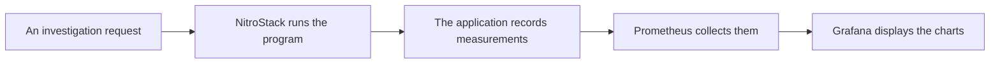

# From a question to a working investigation with NitroStack Code Mode

*Follow a checkout investigation from its first tool call to a Grafana dashboard.*

“Why are customers having trouble checking out?”

It is a short question. Answering it takes more than a short lookup.

An assistant needs to see which services are failing, compare their recent behavior with what came before, check what changed, and read some errors. Then it needs to bring those pieces together into something an engineer can act on.

We built **Incident Desk** to show how that investigation can work with NitroStack. It starts with a few tools and a small program. It ends with an evidence report and a Grafana dashboard that lets us see how the investigation ran.

To understand the application, it helps to start with the idea behind it: Code Mode.

## Before Code Mode, there were individual tool calls

An AI assistant cannot inspect your application just by talking about it. It needs tools: functions that let it do specific things, such as read service metrics or look up a deployment.

The Model Context Protocol, usually shortened to MCP, gives assistants and tools a common way to communicate. The assistant asks a tool for information, the tool returns a result, and the assistant decides what to do next.

That works well for a question with a straightforward answer. If someone asks for the latest deployment, one tool may be enough.

An investigation asks more of the assistant. It may need to work through several services, compare values, and choose where to look more closely. Sending every intermediate result back through the model can add work that a small program could handle directly.

For our checkout question, the procedure might be:

> Look at the services. Compare their error rates and response times. For the ones that have become worse, collect deployment records and error samples. Return the findings together.

There are repeated steps, a comparison, and a decision. That is a good fit for code.

## Code Mode gives the assistant a way to carry out the procedure

**Code Mode lets an AI assistant write a small program that calls tools and works with their results.**

The program can read a list, go through its entries, compare values, and decide which tool to call next. Intermediate data can stay inside the execution while the assistant receives the result it needs for its answer.

Imagine our investigation finding that payments looks normal but checkout has slowed down. The program can skip a deeper payments investigation and collect more evidence about checkout. That decision does not need a separate conversation with the model.

The tools still do the underlying work. Code Mode gives the assistant a way to arrange that work into a procedure. It is particularly useful when a task involves several dependent steps or a collection of records to examine.

A single lookup may still be simplest as a direct tool call. The value appears when there is a procedure worth putting into a program.

## How the idea reached today’s applications

The idea has a history beyond the name. In 2024, researchers working on [CodeAct](https://proceedings.mlr.press/v235/wang24h.html) explored using executable Python code for an agent’s actions. Code gave the agent a way to combine operations and respond to what it discovered.

On **26 September 2025**, Cloudflare introduced [its Code Mode approach](https://blog.cloudflare.com/code-mode/): present tools as a programming interface and let the model write code that uses them. In November that year, [Anthropic described a related approach to code execution with MCP](https://www.anthropic.com/research/code-execution-with-mcp), including processing results before returning them to the model.

By February 2026, Cloudflare had applied the approach to its own large API. Other implementations brought the same broad idea into different environments.

NitroStack added Code Mode in its [1.1.0 release on 8 October 2026](https://docs.nitrostack.ai/docs/changelog), making it available as part of building an MCP application.

## Bringing Code Mode into a NitroStack application

In NitroStack, developers define the tools that their application provides. Those tools contain the actual business logic: reading records, querying a service, or looking up information.

[NitroStack’s Code Mode](https://docs.nitrostack.ai/docs/sdk/transforms/code-mode) adds a way for an assistant to combine those tools in a program. The assistant first finds the tools it needs, checks what inputs they accept, and then submits the program to run.

The three entry points are named `search`, `get_schema`, and `execute`. In everyday terms: **find the tools, understand how to use them, and do the work.**

The submitted program runs in a sandbox, a controlled execution space. NitroStack uses QuickJS, a JavaScript engine, for that execution. The application can put limits on running time, memory, and the number of tool calls.

For developers, this means there is a place to keep the boundaries of the application explicit. We choose the tools the program can reach. We validate what those tools accept. We decide how much work a single execution may do.

In Incident Desk, those choices are deliberately narrow. Its tools only read evidence. An investigation can gather information and produce a report; it has no tool that can restart a service or change a deployment.

That gave us a manageable starting point for building and observing the application.

## Where Cloudflare takes the same idea

Cloudflare’s API server is a useful example at a different scale. It gives an assistant a small interface for finding and executing operations across a large API. The generated JavaScript runs in a Cloudflare Worker environment, with access to the capabilities supplied to it. [Cloudflare’s API-server explanation](https://blog.cloudflare.com/code-mode-mcp/).

NitroStack lets us put Code Mode inside our own Node.js application, with the tools and execution limits we define. Cloudflare provides an implementation on its Workers platform.

Both show the same change in how an assistant can work: a program can connect several operations and handle the data between them. The runtime and deployment choices are different.

For this project, we used NitroStack so the application, its tools, and its monitoring could run together locally. A developer can try the complete example without a cloud account or a model API key.

## Back to the checkout question

Incident Desk uses a fixed set of **synthetic data** for three services: checkout, inventory, and payments. This makes the example repeatable. Everyone running it can follow the same investigation.

We give the application four ways to collect evidence. It can list services, compare their metrics, look up deployments, and read error samples.

The investigation starts by listing the services. It then compares two observation windows for each one.

Payments looks steady. Its error rate is unchanged. Checkout is different: errors have risen from **0.5% to 6%**, and its response time has increased sharply. Inventory has a smaller rise in errors, from **1.2% to 1.8%**.

Those comparisons tell the program where to look next. It collects deployment records and error samples for checkout and inventory, while leaving payments out of the deeper investigation.

A small part of that evidence gathering looks like this:

```javascript
const metrics = await callTool('metrics_compare', { service: 'checkout' });
const deployments = await callTool('deployments_list', { service: 'checkout' });

return { metrics, deployments };
```

Each line asks a tool for one piece of information. The [complete workflow](workflows/triage.js) adds the comparisons, decisions, and final report.

In total, it makes **eight tool calls inside one execution**. It returns checkout as a critical finding and inventory as something to watch. Checkout’s report includes a recent deployment and address-provider timeout errors, giving an engineer a concrete next step: compare that change with the errors.

The report preserves that distinction. A nearby deployment is a lead to investigate, not proof of the cause.

The default demo runs this reviewed program, so its first result is predictable. We also expose the application through MCP. An AI client can discover the same tools and write a different investigation program for a different question.

The report gives us evidence about checkout. To operate this application, we also need to understand how the investigation itself ran.

## Making the investigation visible with Grafana

An evidence report tells us what the program found. It does not tell us how long the program waited, how many tool operations it performed, or whether other executions failed.

Those details matter once people start using the application. We want to know whether it is getting slower, where time is going, and whether it can keep up with incoming work.

So we added measurements around NitroStack’s execution path. Each run records its outcome, duration, and tool activity. Prometheus collects those measurements, and Grafana turns them into charts.

The relationship is simple:



NitroStack runs the investigation while Grafana gives us a view of its behavior.

We use the same measurement path for the demo and scripts submitted through MCP within that application process. That lets us look beyond a successful example and see how executions are behaving over time.

## Reading the dashboard as the work happens

Open the dashboard and begin at the top. It shows how many executions have completed, how many succeeded, and how many tool operations a run used on average.

Below that, the graphs show the pace of incoming completed work and how long executions took. Tool-activity charts show which operations were used. Other panels show work currently running or waiting, along with requests that could not be admitted because the application was at capacity.


The screenshot includes failures we deliberately introduced to exercise the monitoring. They are actual failed executions of demo scripts. They are not failed customer checkouts or an evaluation of an AI model’s accuracy.

The duration chart includes a measure called p95: an estimate of the time below which about 95% of the recent observed executions finished. It helps us see slower runs that an average can hide.

If investigations begin taking longer, we can look at tool durations and waiting work alongside them. If capacity rejections rise, we have a reason to examine how much work the application is accepting. The dashboard gives us a starting point for investigating the investigator.

Farther down, we return to the original checkout problem.


This section shows the service data used by the investigation: error rates before and after, response times, and the findings from the latest successful run. Checkout’s change is easy to see, inventory’s smaller change remains visible, and payments provides a steady comparison.

The dashboard labels this evidence as a fixed demo snapshot. That keeps it separate from the live measurements of our program running. One tells us about the example incident; the other tells us about the application investigating it.

## Run your first investigation

The [Incident Desk repository](https://github.com/satyampsoni/incident-desk) includes the NitroStack application, the investigation program, and the Grafana and Prometheus configuration.

From the project directory, start the stack:

```bash
docker compose up -d --build
```

Then run an investigation:

```bash
curl -sS http://127.0.0.1:4310/api/investigate \
  -H 'Content-Type: application/json' -d '{}'
```

Open [Grafana](http://127.0.0.1:4311/d/incident-desk) and follow the execution. The [README](README.md) explains how to generate more activity, connect an MCP client, and configure the local environment. The [decision record](DECISIONS.md) covers the engineering choices and current limitations.

We began with a checkout question that needed several pieces of evidence. With NitroStack Code Mode, a program can gather those pieces and bring them together. With Grafana, we can also see the work behind that answer.

For a team building AI applications, that is a useful place to begin: give the assistant a procedure it can carry out, define the tools it may use, and make the execution visible to the people responsible for it.

---

*The application runs real Code Mode executions against synthetic incident data. It does not establish a token-saving or model-performance benchmark. The supporting [benchmark notes](docs/research/CODE_MODE_BENCHMARKS.md), [source register](docs/research/CODE_MODE_SOURCES.md), and [verification record](docs/VERIFICATION.md) are available for readers who want the research and implementation detail.*
