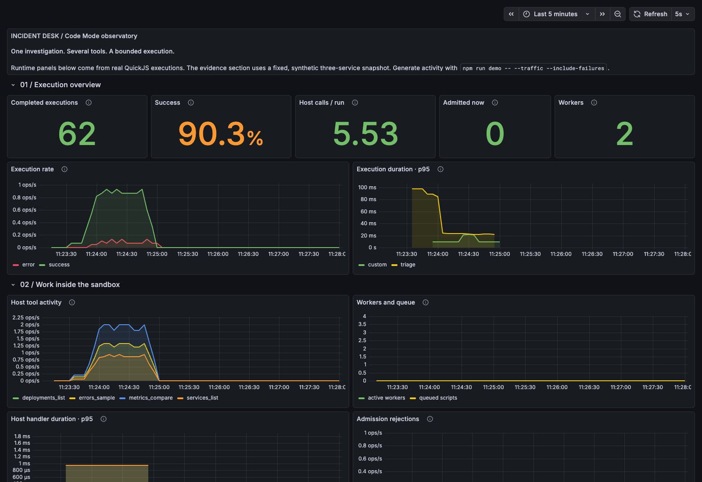
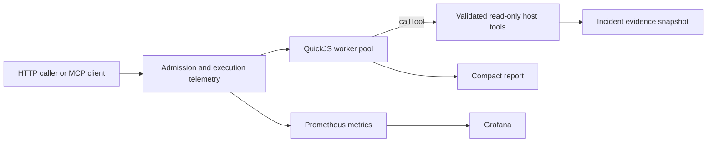

# Incident Desk

Investigate a service regression with one sandboxed JavaScript workflow, then watch the execution in Grafana.

Incident Desk compares service metrics, fetches deployment and error evidence for services that cross a threshold, and returns a ranked report. It uses **NitroStack 1.1.3 Code Mode**, **QuickJS WebAssembly**, **Prometheus**, and a provisioned **Grafana** dashboard.

The included incident is synthetic. The sandbox executions, tool calls, metrics, scrape pipeline, and Grafana dashboard are real. No LLM key or cloud account is required for the example.



## Run the complete stack

Requires Docker Desktop or Docker Engine with Compose v2. Ports 4310, 4311, and 4312 must be available. The images are pinned by digest; the first build downloads them.

```bash
cd incident-desk
docker compose up -d --build
```

Then run an investigation:

```bash
curl -sS http://127.0.0.1:4310/api/investigate \
  -H 'Content-Type: application/json' -d '{}'
```

Open [the Grafana dashboard](http://127.0.0.1:4311/d/incident-desk). Viewing requires no login. The local administrator is `admin` with password `incident-desk-local`; override that in `.env` if needed. Every published port binds to `127.0.0.1`.

The expected report identifies:

| Service | Finding | Evidence |
| --- | --- | --- |
| checkout | critical | Errors rise from 0.5% to 6%; p95 rises from 210 ms to 1,480 ms; a deployment and address-provider timeouts are present |
| inventory | watch | Errors rise from 1.2% to 1.8%; no deployment is included in the snapshot |
| payments | healthy; omitted from findings | Error rate remains 0.5%; latency changes little |

The workflow makes **eight host tool calls inside one execution**. The deployment is a lead to investigate, not a proven cause. A captured response is in [docs/examples/investigation.json](docs/examples/investigation.json).

If Docker's data volume is full, use the disposable variant without deleting other Docker data:

```bash
docker compose -f compose.yaml -f compose.ephemeral.yaml up -d --build
```

That variant requires Compose 2.24.4 or newer and stores Prometheus and Grafana data in memory; it resets when those containers are recreated. It is the variant used for the checked-in screenshots. The default stack uses named volumes.

## Generate activity and verify it

The helper scripts require Node.js 22 or 24. To install dependencies and compile:

```bash
npm ci
npm run build
npm run demo
npm run demo -- --traffic --include-failures --count 60
npm run smoke:stack
```

Traffic generation runs for roughly one minute. Every tenth execution intentionally throws an error. This fills the success and failure graphs with actual executions; it is not a performance benchmark. Prometheus scrapes every five seconds. Rate and histogram panels need multiple scrapes, so give them a short window to populate.

The smoke check verifies the report, actual Prometheus ingestion, Grafana provisioning, every dashboard query, and three evaluated alert rules. It writes evidence to [docs/examples/stack-verification.json](docs/examples/stack-verification.json).

## How Code Mode works here



An MCP client sees three meta-tools: `search`, `get_schema`, and `execute`. It can discover the underlying capabilities, inspect their inputs, then submit a short ES2020 program. The program calls tools through `await callTool(name, args)` and returns its final value. The host process validates arguments and runs the handlers.

For a repeatable demonstration, `POST /api/investigate` submits the reviewed [triage workflow](workflows/triage.js). It does not generate code or call a model. `POST /api/execute` accepts a custom script, and the optional MCP transport lets a real AI client write that script. Both execution paths share admission, limits, run history, and telemetry.

```javascript
const catalog = await callTool('services_list', {});
const comparisons = [];
for (const service of catalog.services) {
  const metrics = await callTool('metrics_compare', { service: service.id });
  comparisons.push({ service: service.id, errorRate: metrics.after.errors / metrics.after.requests });
}
return comparisons;
```

Guest code has no `process`, `require`, `fs`, or `fetch`. Its only data access is the tool bridge. A script is a bounded computation, not a transaction: host tool calls are separate operations, and the sandbox cannot undo side effects. This application exposes four read-only tools.

## Dashboard

The dashboard contains execution totals and success rate, run p95, calls per run, host-tool throughput and latency, current workers and queue, admission rejections, process memory, result size, and a separately labeled evidence section.

- Execution metrics measure real application behavior.
- Evidence bars show the **fixed synthetic snapshot**, observed at 10:00 UTC on 17 November 2026.
- Finding counts update after the canonical triage workflow succeeds. Custom scripts do not publish findings.
- Run p95 is an estimated histogram quantile. It can be blank without recent observations.
- Process RSS includes worker memory; V8 heap is not a measurement of QuickJS allocations.
- Five-second scrapes can miss brief worker and queue peaks.

The dashboard JSON is [here](observability/grafana/dashboards/incident-desk.json). Edit [scripts/dashboard.mjs](scripts/dashboard.mjs), run `node scripts/dashboard.mjs`, and let Grafana reload it. Provisioned dashboards are intentionally read-only in the UI. Alerts are evaluated in Prometheus; notification delivery is not configured.

## Local development and MCP

Run the application without containers:

```bash
npm ci
npm run build
npm start
```

To connect an MCP client, use an absolute project path and a Node.js 22 or 24 executable:

```json
{
  "mcpServers": {
    "incident-desk": {
      "command": "/absolute/path/to/node",
      "args": ["/absolute/path/to/incident-desk/dist/src/main.js", "--stdio"],
      "env": { "PORT": "4313", "HOST": "127.0.0.1" }
    }
  }
}
```

Ask the client: “Inspect the available tools, compare service error rates and latency, and collect deployment and error evidence for the services that regressed.”

This starts a **separate process**, with metrics at `http://127.0.0.1:4313/metrics`. The default container dashboard observes the container process at `app:4310`, not this additional process. To monitor the MCP process on Docker Desktop, add a second Prometheus scrape job targeting `host.docker.internal:4313`; filter or separate instances when comparing totals. Standard output carries only MCP messages; execution logs go to standard error.

## HTTP interface

| Endpoint | Purpose |
| --- | --- |
| `GET /healthz` | Liveness and evidence source |
| `GET /metrics` | Prometheus exposition |
| `GET /api/catalog` | Raw tool schemas, snapshot identity, configured limits |
| `GET /api/runs` | Last 100 execution summaries, newest first |
| `POST /api/investigate` | Run the canonical workflow; body `{}` |
| `POST /api/execute` | Run a custom script; body `{"code":"return 42;"}` |

Set `API_TOKEN` to require a bearer token for `/api/*`. Health and metrics remain available to local scrapers. Browser-origin API requests are rejected. The stdio transport relies on the local process boundary and does not use this HTTP token. Compose reads `.env`; native commands and the helper scripts use exported environment variables, so export the same token when running those helpers.

Execution errors return HTTP 422, invalid inputs 400, oversized HTTP bodies 413, and admission pressure 429 with `Retry-After: 1`. Completed failed runs and pre-admission rejections have separate counters. Clients should retry 429 with bounded backoff; they should not blindly retry arbitrary scripts.

## Configuration and boundaries

| Variable | Default | Meaning |
| --- | --- | --- |
| `PORT` / `HOST` | `4310` / `127.0.0.1` | Native HTTP listener; Docker sets host to `0.0.0.0` internally |
| `API_TOKEN` | unset | Optional HTTP API bearer token |
| `SNAPSHOT_PATH` | `data/snapshot.json` | Evidence JSON, loaded and validated once at startup |
| `SANDBOX_WORKERS` | `2` | QuickJS worker count |
| `SANDBOX_TIMEOUT_MS` | `3000` | Per-execution SDK deadline |
| `SANDBOX_MEMORY_MB` | `64` | Per-sandbox memory limit |
| `SANDBOX_MAX_TOOL_CALLS` | `24` | Tool-call budget per script |
| `MAX_IN_FLIGHT` | `4` | Admitted running plus waiting scripts |

HTTP bodies are capped at 48 KiB, code at 32 KiB, and serialized successful result values at 256 KiB. History is memory-only and capped at 100 summaries. Result-size validation happens after the SDK returns, so it is not a host-memory allocation cap. Fixture input supports up to 20 services, one million requests per window, and 20 deployments/error samples per service. When expanding the fixture, size the tool budget for `1 + services + 2 × flagged services`; the default 24-call budget is for this small example.

To use real evidence, replace the snapshot with an exported JSON file matching [src/snapshot.ts](src/snapshot.ts), or replace the four host handlers in [src/runtime.ts](src/runtime.ts) with bounded, authenticated backend queries. Preserve the tool contracts, use abortable I/O with independent timeouts, redact sensitive fields, and revisit freshness and authorization before exposing a network service.

## Tests and known limitations

```bash
npm test
docker compose exec prometheus promtool check rules /etc/prometheus/alerts.yml
docker compose exec prometheus promtool check config /etc/prometheus/prometheus.yml
```

Ten integration tests exercise real QuickJS execution, fixture correctness, capability isolation, fresh interpreters, validation, nested-meta-tool rejection, CPU timeout and recovery, tool budgets, bounded admission, output limits, HTTP boundaries, and MCP discovery/execution. [Verification details](docs/VERIFICATION.md) record what was actually checked.

NitroStack 1.1.3 creates an import-time rate-limit cleanup timer that survives server shutdown. `npm ci` applies a narrow checked patch to call `.unref()` on that timer. [The patch](scripts/patch-nitrostack.mjs) fails if the expected SDK source changes.

The dependency audit reports a high-severity Zod collection-validation advisory affecting the SDK's Zod 3 dependency. The current SDK has no compatible audited fix. This example bounds HTTP payloads and fixture size and uses scalar tool arguments, but it is a **local development example**, not a hardened public multi-tenant execution service. See [DECISIONS.md](DECISIONS.md) for the dependency tradeoff and the exact advisory.

## Further reading

- [BLOG.md](BLOG.md): an introduction to Code Mode through the NitroStack investigation and Grafana dashboard.
- [Published benchmark notes](docs/research/CODE_MODE_BENCHMARKS.md): quantitative comparisons and their limitations.
- [Code Mode research register](docs/research/CODE_MODE_SOURCES.md): Cloudflare and Substack sources, evidence quality, and benchmark caveats.
- [DECISIONS.md](DECISIONS.md): alternatives, tradeoffs, limits, and upgrade considerations.
- [docs/VERIFICATION.md](docs/VERIFICATION.md): test and stack evidence.

Stop the stack with `docker compose down` (use the same `-f` options if using the disposable variant). Default named volumes are retained. The project uses Apache-2.0; see [LICENSE](LICENSE).
